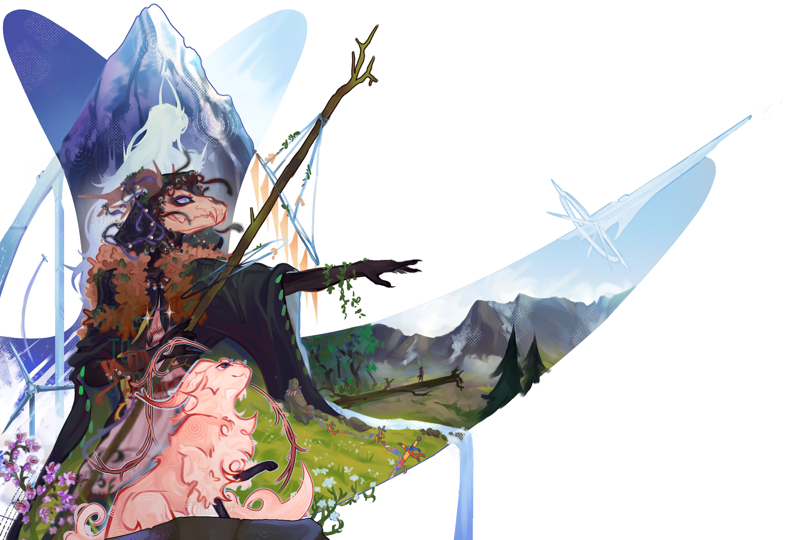
## Питч
Название: Орион Каелас
Жанр: 2D-платформер с элементами метроидвании и выживания
Движок: Unity
Платформы: ПК

Орион Каелас - это классическая 2D-метроидвания от 3-го лица, разворачивающаяся в уникальном мире Ориона, где переплетаются магия, высокие технологии и многовековая история. Под нашим управлением оказывается пушистое существо, именуемое **салариком**, которое неожиданно для себя начинает всё глубже осознавать и чувствовать окружающий мир. Игроку предстоит атмосферное путешествие по забытой островной цивилизации, знакомство с ярким кастом персонажей и попытка разобраться что же с ним произошло на самом деле. 

Одной из основных фишек игры является **эволюция**: по мере развития сюжета саларик будет становиться всё сообразительнее, открывать для себя новые способности. Игрок вместе с персонажем будет всё больше понимать о происходящем вокруг него, пока не выстроит полную картинку и не достигнет вершины своей эволюции. 

## ЦА и референсы

Главными референсами проекта являются игры того же жанра с продуманными мирами и выверенной атмосферой.

| Название игры           | Её основные фишки                                                                                                                                                                                                                                                                         | Обложка                                                 |
| ----------------------- | ----------------------------------------------------------------------------------------------------------------------------------------------------------------------------------------------------------------------------------------------------------------------------------------- | ------------------------------------------------------- |
| Hollow Knight           | 2D-метроидвания, породившая интерес к жанру и ставшая одним из главных вдохновений в разработке                                                                                                                                                                                           | 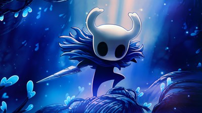 |
| Hollow Knight: Silksong | Вторая часть легендарной игры, более сфокусированная на сюжете и обладающая ярким визуалом, который также служит вдохновением для нашего проекта                                                                                                                                          | 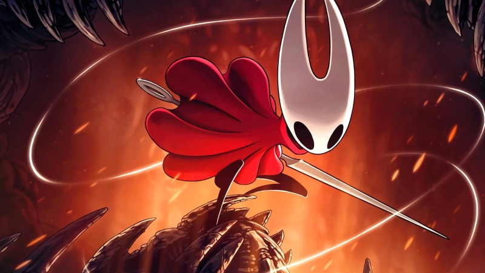                        |
| Rain World              | Сложная и атмосферная игра, основной задумкой которой является активное взаимодействие с экосистемой, добыча пищи и сражение с хищниками. Эта игра побудила в нас идею сделать геймплей от лица персонажа-животного, который будет сталкиваться со свойственными дикой природе проблемами | 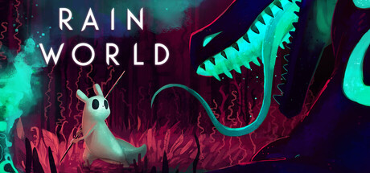                                  |
| Nine Sols               | Сюжетная метроидвания, плотно основанная на даосизме. Она легла в основу идеи сделать игру, плотно связанную с сеттингом мира, который также во многом основан на азиатской культуре                                                                                                      | 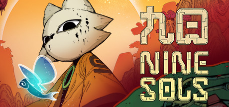              |

Целевая аудитория нашей игры состоит из преданных фанатов атмосферных двухмерных приключений, которые ценят глубокое погружение в проработанные миры и меланхоличную, загадочную атмосферу. Эти игроки любят исследовать запутанные локации, открывать секреты и постепенно распутывать сложный сюжет через окружение, диалоги и детали окружения, как это происходит в Hollow Knight или Rain World. Однако ключевое отличие нашего проекта заключается в более мягком пороге вхождения. Мы ориентируемся на ту часть геймеров, которая очарована эстетикой Nine Sols или историей о разумных животных, но часто пасует перед изнурительной сложностью, хардкорным платформингом или жестокими битвами с боссами. Наш пользователь ищет в меру бросающий вызов, но при этом комфортный игровой процесс, где на первом месте стоит эстетическое удовольствие, эмоциональная привязанность к главному герою и желание узнать, чем закончится его история, без необходимости перепроходить один и тот же боевой участок десятки раз.

## Игровые столпы
| Эволюция главного героя, как в геймплейном, так и в нарративном плане                                                                    | "Метроидвания" во всех смыслах слова, развитие персонажа плотно сопряжено с лором мира                                                                                                                                                                                                                      |
| ---------------------------------------------------------------------------------------------------------------------------------------- | ----------------------------------------------------------------------------------------------------------------------------------------------------------------------------------------------------------------------------------------------------------------------------------------------------------- |
| Полностью оригинальный сеттинг                                                                                                           | Привлечение внимания необычными персонажами, их культурой, визуальными и стилистическими решениями                                                                                                                                                                                                          |
| <mark style="background:rgba(205, 244, 105, 0.55)">Постоянное взаимодействие с напарником - Альтаиром</mark>                             | Его можно расспрашивать вещах, он проводит туториал, он сопровождает нас по всему ходу нашего приключения, помогая игроку                                                                                                                                                                                   |
| Исследование мира                                                                                                                        | Игрок путешествует по абсолютно новому миру, открывая для себя как и новые геймплейные механики, так и сюжетные секреты, проливающие свет на прошлое мира. Механика следует стандарту метроидваний и отлично работает в угоду "эволюции", она должна быть привлекательна нарративно и обоснована геймплейно |
| <mark style="background:rgba(205, 244, 105, 0.55)">Трагичная история мира с необычной философией, но при этом приятной атмосферой</mark> | Необычный и жизнеутверждающий контраст, выделяющий произведение на фоне других метроидваний (соус-лайков), что наполнены более мрачной атмосферой                                                                                                                                                           |

## Геймплей и механики

Геймплейный цикл очень близок к метроидваниям-референсам. Как таковые уровни отсутствуют, есть различные локации, поделённые на сегменты, а игрока движет вперёд не желание пройти уровень, а желание исследовать и узнавать. Основная ценность геймплея - исследование мира вокруг, а потому особый упор делается на интересности этого самого мира. В рамках демоверсии интерес вызывается необычной структурой локации, визуалом и общей таинственностью.
Игра позиционирует себя как сюжетная с глубоким погружением в очень необычный мир со своей огромной историей, персонажами, культурой и философией. Несмотря на то, что мы играем за кота, мы всё ещё будем способны прочувствовать всё то, что через проходит мир игры. 

| Название механики         | Описание                                                                                                                                                                                                                                                                                                                                                                                                                                                                                                                                        | Система управления и взаимодействия с другими механиками |
| ------------------------- | ----------------------------------------------------------------------------------------------------------------------------------------------------------------------------------------------------------------------------------------------------------------------------------------------------------------------------------------------------------------------------------------------------------------------------------------------------------------------------------------------------------------------------------------------- | -------------------------------------------------------- |
| Передвижение              | Базовое для 2D-метроидваний перемещение, в силу отсутствия рывка в данном сегменте должно быть достаточно быстрым                                                                                                                                                                                                                                                                                                                                                                                                                               | A/D                                                      |
| Прыжок                    | С регуляцией высоты, ощущение прыжка более резкое и "живое" с быстрым подъёмом верх, зависанием и быстрым спуском вниз. При небольшом недолетании до платформы игрок "цепляется" за край и проигрывается анимация долетания. Базовое время койота присутствует.                                                                                                                                                                                                                                                                                 | Space                                                    |
| Лазание                   | При нахождении рядом с тонкой палкой игрок может схватиться за неё, зажав W.  1. При вертикальном лазании при зажатии W/S игрок будет двигаться в выбранном направлении. При приближении к обрыву снизу саларик остановится на некоторое время, если игрок продолжает жать S, то он соскальзывает вниз; 2. Из положения лазания также будет доступен прыжок в сторону (A/D), при нажатии прыжка без направления саларик слегка подпрыгнет и отпустит палку. 3. Саларик может залезть на верхний конец вертикальной палки и встать там. | W/S, при ползании в сторону доступны A/D                 |
| Толкание предметов        | У некоторых объектов будет дополнительная возможность двигать их, если игрок начнёт их толкать с какой-либо из сторон. При этом скорость игрока несколько сократится, а предмет начнёт перемещаться.                                                                                                                                                                                                                                                                                                                                            | A/D при нахождении перед персонажем толкаемого предмета  |
| Перенос предметов         | Особые объекты можно "взять в рот", тем самым перенося их. Для этого игроку нужно единоразово нажать E, после чего предмет окажется привязанным к нему. Дабы опустить предмет, нужно снова нажать E. С предметом во рту можно лазать и прыгать.                                                                                                                                                                                                                                                                                                 | E                                                        |
| Смерть                    | При падении в пропасть игрок автоматически респавнится в начале сегмента/комнаты. Иного штрафа за этой действие в рамках демоверсии не предусмотрено.                                                                                                                                                                                                                                                                                                                                                                                           | Нету                                                     |
| Диалоговое взаимодействие | Всю демоверсию нас будет сопровождать ещё один персонаж, переговариваясь с нами и обучая (проводя tutorial). Его фразы будут триггериться на определённые действия игрока (проход через особые области, взаимодействие с предметом, долгие ожидания и проч).                                                                                                                                                                                                                                                                                    | Нету                                                     |
| Иные графические механики | Также реагируют на перемещение игрока, являются чисто визуальными механиками, изменяющими спрайты в зависимости от действий персонажа.                                                                                                                                                                                                                                                                                                                                                                                                          | Нету                                                     |

## Мир
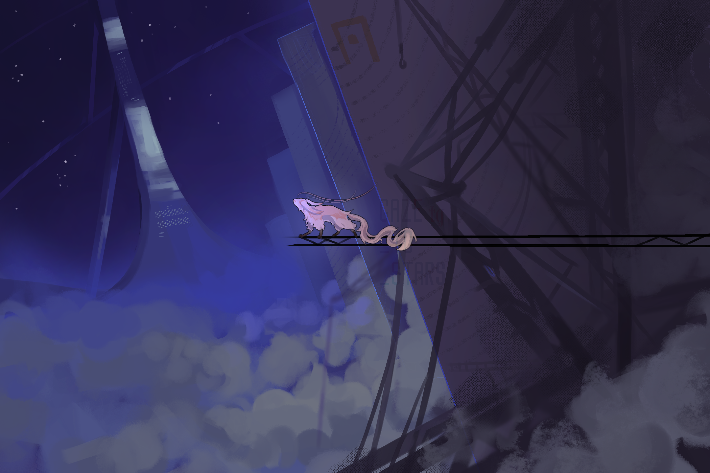
Геймплей демоверсии будет происходить в одной локации, поделённой на различные паркур-сегменты и небольшие головоломки. Игрок как бы "совершает восхождение" в абсолютно незнакомой и непонятной как ему, так и персонажу локации. А вперёд его ведёт таинственный голос, раздающийся неизвестно откуда. На пути игроку будут встречаться красивые виды, гигантские конструкции, неизвестные технологии и прочее. В конце - на самой вершине локации - саларик узреет бескрайнее поле, и на том демоверсия **ВСЁ**.
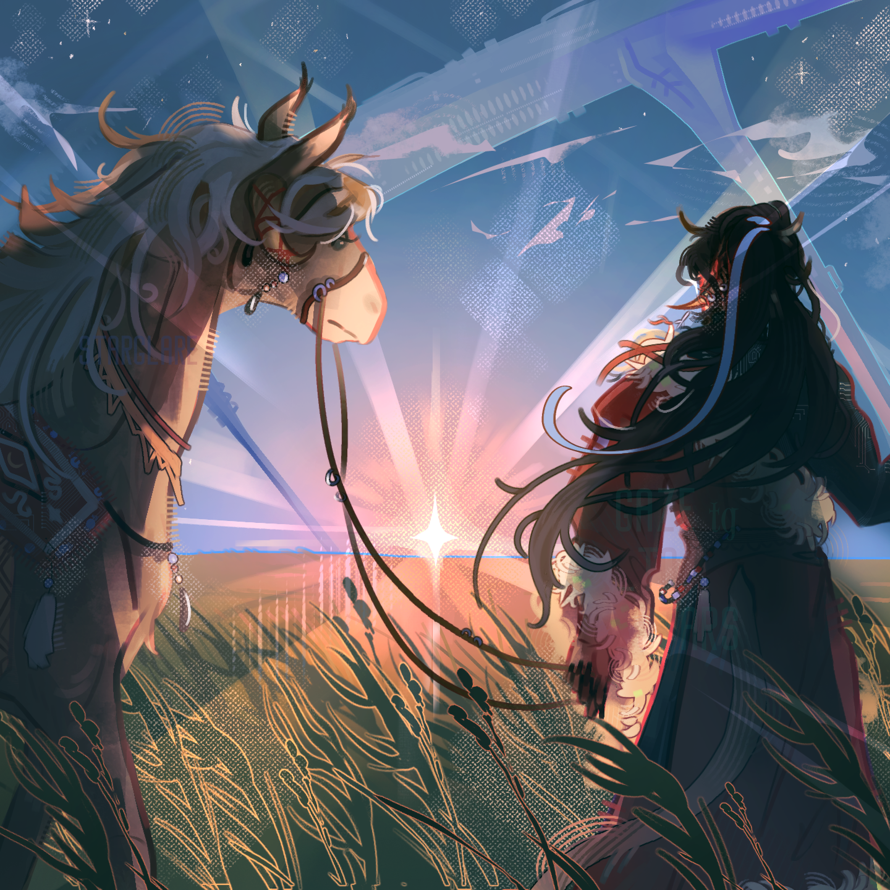

Набросочная структура локации:
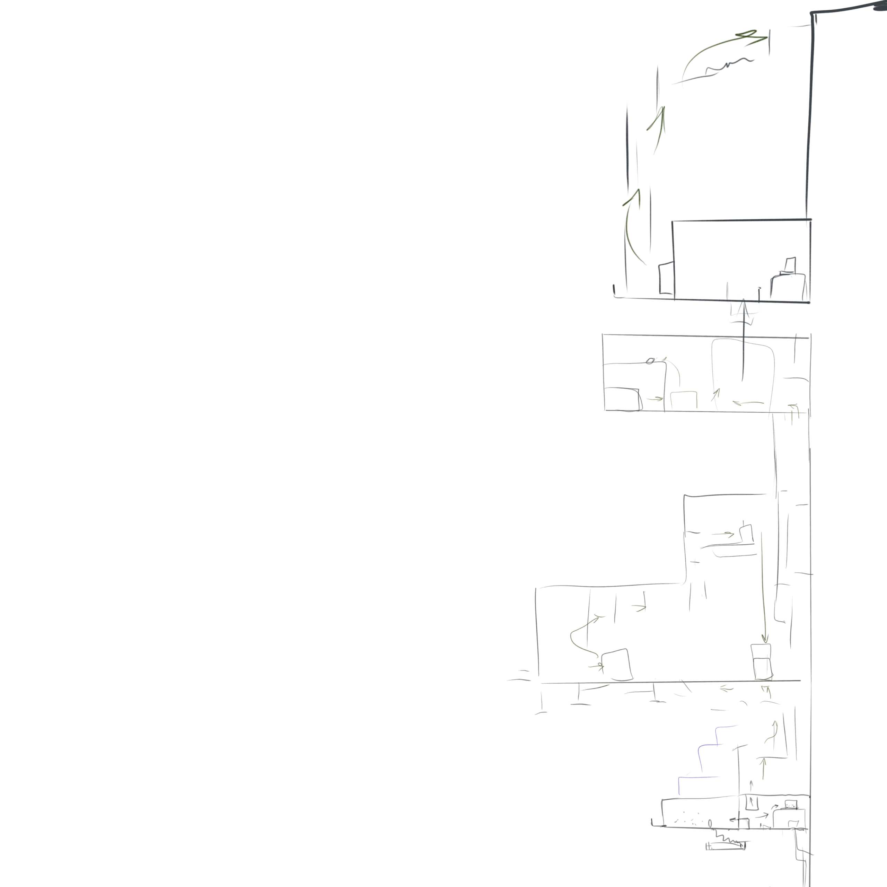

| Комната                                                       | Что в ней находится                                                                                                                                                                                                                                                                                                                                                                                                                                                            |
| ------------------------------------------------------------- | ------------------------------------------------------------------------------------------------------------------------------------------------------------------------------------------------------------------------------------------------------------------------------------------------------------------------------------------------------------------------------------------------------------------------------------------------------------------------------ |
| Стартовый сегмент - самая нижняя платформа на границе карьера | Металлическая платформа со ступеньками, ведущими куда-то наверх. Демонстрирует масштабность всей локации и задаёт общий тон всей демоверсии.                                                                                                                                                                                                                                                                                                                                   |
| Первая комната внутри конструкции                             | Левая комнатка с балконом, с которого можно ещё полюбоваться видами. В правой части находится переход в следующую комнату, возможно добавление дополнительных механик.                                                                                                                                                                                                                                                                                                         |
| Компьютерная комната №1                                       | Закрывается после захода игрока в неё. Внутри находится несколько интерактивных предметов, в том числе и компьютерный стол, где игрок имеет возможность походить по клавиатуре. Когда он это сделает достаточное количество времени, система заработает, а игроку откроется маршрут наверх                                                                                                                                                                                     |
| Первый паркурный сегмент                                      | Большая комната, разбитая на несколько планов камеры и вводящая конструкции для лазания. Изначально движение идёт наверх к потолку следующего сегмента, дальше маршрут пролегает горизонтально влево над пропастью, где игрок может сорваться вниз. В самом конце горизонтали есть небольшой проход наверх, где игрок попадет в следующую комнату                                                                                                                              |
| Первый сегмент с толканием                                    | Ещё одна просторная комната, в которой игрок впервые познакомится с толканием предметов. Изначально ему нужно будет подвинуть первый предмет, чтобы дотянуться до лазательного сегмента, по которому он может залезть под потолок, чтобы в дальнейшем повзаимодействовать с ещё одним передвигаемым объектом, который необходимо сдвинуть вниз. Это позволит игроку дотянуться до следующего лазательного сегмента в правой части комнаты и залезть выше, в следующую комнату. |
| Комната с тасканием предмета во рту                           | Здесь игроку снова предлагается силой передвинуть тяжёлый объект, чтобы забраться на высокую платформу и оттуда взять в зубы некий предмет, что откроет ему дверь дальше.                                                                                                                                                                                                                                                                                                      |
| Компьютерная комната №2                                       | Попадая в эту комнату, игроку становится недоступен путь куда-либо, пока он снова не походит по клавиатуре. После этого ему откроется дверь налево.                                                                                                                                                                                                                                                                                                                            |
| Второй паркурный сегмент                                      | Игроку предлагается снова взобраться выше, перемещаясь между платформами с помощью лазания.                                                                                                                                                                                                                                                                                                                                                                                    |
| Финал                                                         | Сегмент - гигантское поле, которое простирается на самом верху карьера. Несёт больше нарративный посыл, чем геймплейный. Немного пройдя по нему, игрок попадёт в катсцену и на этом демоверсия завершится.                                                                                                                                                                                                                                                                     |

## Сеттинг и сюжет
Сеттинг: мир Орион Каелас, полностью оригинальная вселенная, переплетающая в себе сай-файные технологии и этническую магию.
.png)

| 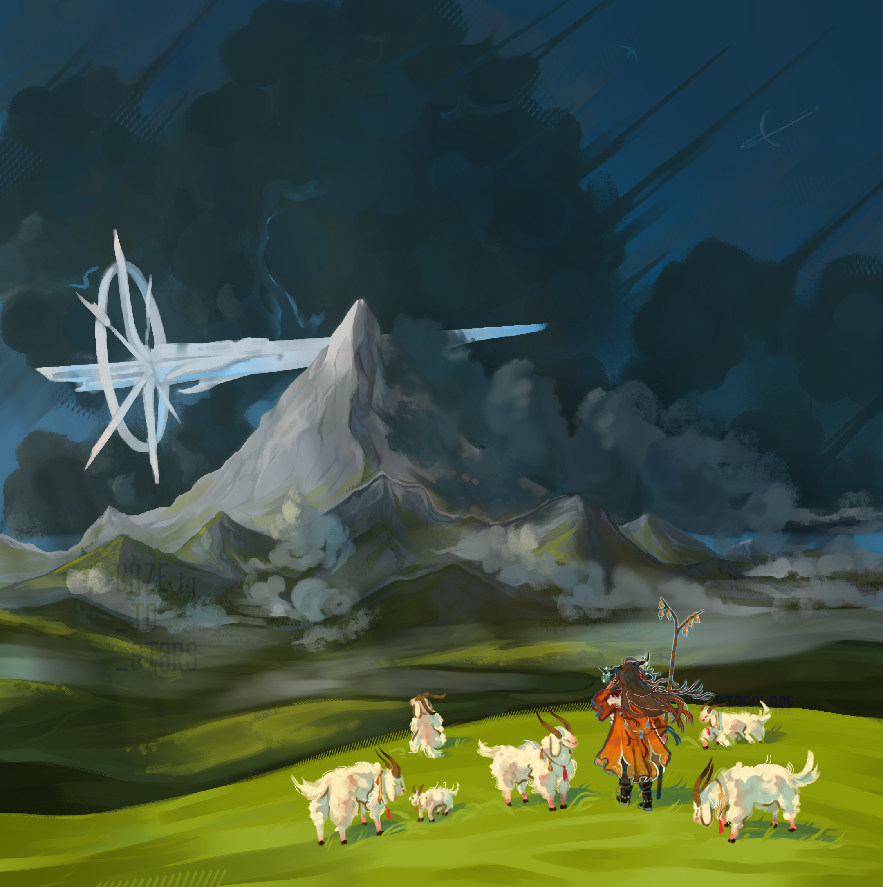 | 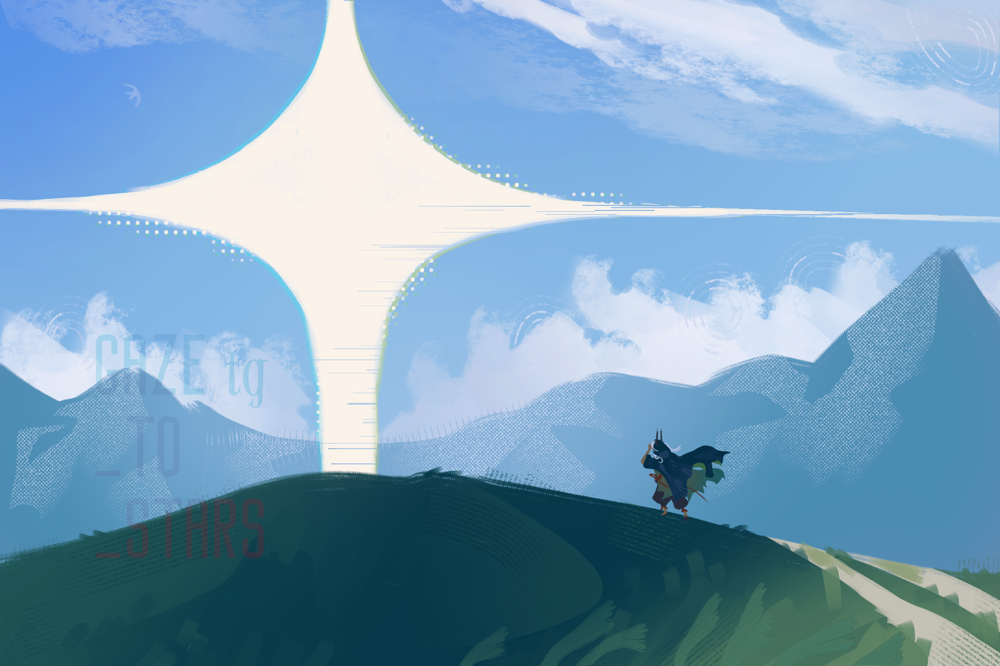 |
| -------------------------------------------: | ----------------------------------------: |
|                      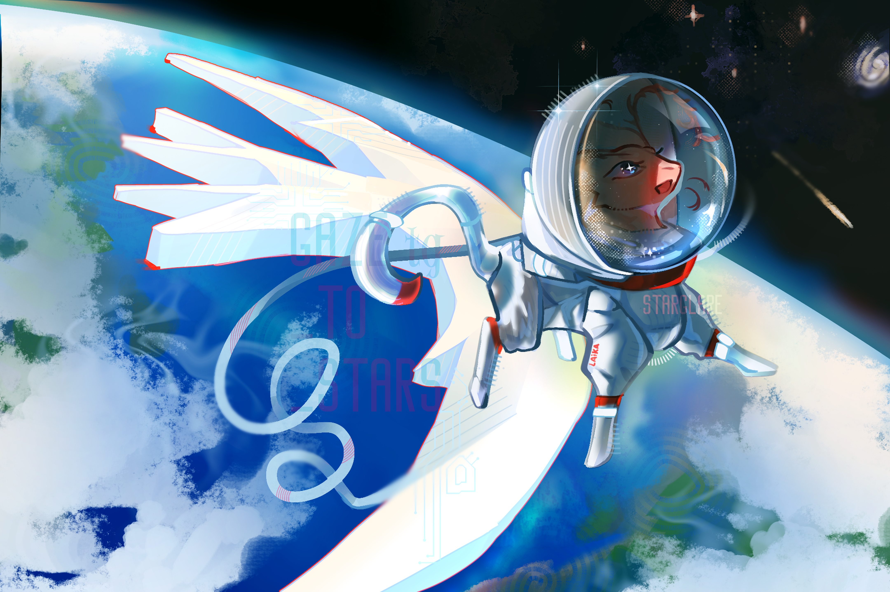 |              |

Основной персонаж: безымянный <mark style="background:rgba(240, 167, 216, 0.55)">саларик</mark>, которому даровало разум сверхмогущественное существо. Зверёк будет по ходу истории становиться всё умнее и буквально эволюционировать, пока не дойдёт до полной осознанности и разумности к финалу. Открытие новых игровых механик поделено на две части:
1. Эволюционная - местная магия, физические изменения;
2. Мысли - использование технологий и инструментов, разумность. 
Путь игрока плотно связан с лором и идеями буддизма - в процессе своего путешествия саларик постепенно будет достигать духовного просветления, но может свернуть с этого пути. 
Даровал разум существу Альтаир из своих побуждений.
- Ему было одиноко, поскольку его бытиё было уже некому разделить из-за падения цивилизации.
- Альтаир жаждал как-то исправить ситуацию и, возможно, создать новую цивилизацию/надежду для неё.
- Ему хотелось решить давнишнее уравнение по искусственному возвышению низшего существа, которое до этого не давалось никому.
- Чистый научный интерес.
Вместе с разумом к саларику придёт ещё множество моральных дилемм, первая из них - ответственность за свои действия, с которой он, уже будучи не животным, должен быть встретиться лицом к лицу. Она же несёт за собой отсутствие безгрешности, теперь каждое его действие может быть рассмотрено с точки зрения морали. Позже саларик начнёт задаваться вопросами о прошлом этого места, о его падении и возможных исходах, о жизни и смерти. Это и то, что после возвышения он больше не будет вхож в звериное общество, заставит его двигаться вперёд в как-либо из смыслов.

| Концовка                                                                            | Последствия                                                                                                                                                                                |
| ----------------------------------------------------------------------------------- | ------------------------------------------------------------------------------------------------------------------------------------------------------------------------------------------ |
| Принятие новой реальности, вознесение до высшего существа                           | Полная потеря прошлой жизни, тяжёлое бремя разума и понимания всей трагедии этого мира. Неизвестность, но следование Альтаиру                                                              |
| Отказ перехода на новую ступень, саларик остаётся в том же состоянии, не возвышаясь | Животинка также выпадает из привычного общества, но со временем потеряет значимую часть полученного разума, что дарует ей частично освобождение и покой. Незавершённость, но не разрушение |
| Полный отказ от новой сущности, маниакальное желание избавиться от новой роли       | Отменить созданное нельзя, животинку ожидает лишь "смерть" в ядре Салария, от имени тех, кто не сумел смериться с тягостью мира.                                                           |
Центральными мыслями всей игры являются:
1. Дилемма цивилизации и божественности - *когда мы разовьёмся насколько, что сможем считать себя богами? Любая ли цивилизация обречена на гибель?*
2. Мы в ответе за тех, кого приручили - *имеет ли право более сильное существо ломать жизнь более слабому, пусть и не напрямую и для благой цели?* 
3. Существование в рамках разрушенного мира, взаимодействие с его прошлым и оставшимися жителями, однако несущее за собой жизнеутверждающее чувство.
## Управление и камера
авыавы

## UI/UX
В демоверсии будет использован довольно мало дизайна и меню. Как такового инвентаря или профиля игрока не предполагается в рамках демоверсии, потому UI будет использоваться в первую очередь для диалоговых сегментов и всплывающих подсказок, объясняющий на какую кнопку жать и куда двигаться.  

Возможно добавление экрана паузы, загрузочный экран пока не предполагается???

## Графика
В игре будет использоваться нарисованная от руки 2D-графика с применением параллакса и 3D-моделей по необходимости. Вся графика будет выполнена в стилизованном стиле, отличающимся контурами, яркими цветами и использованием текстурных кистей при прорисовки персонажей и окружения. 
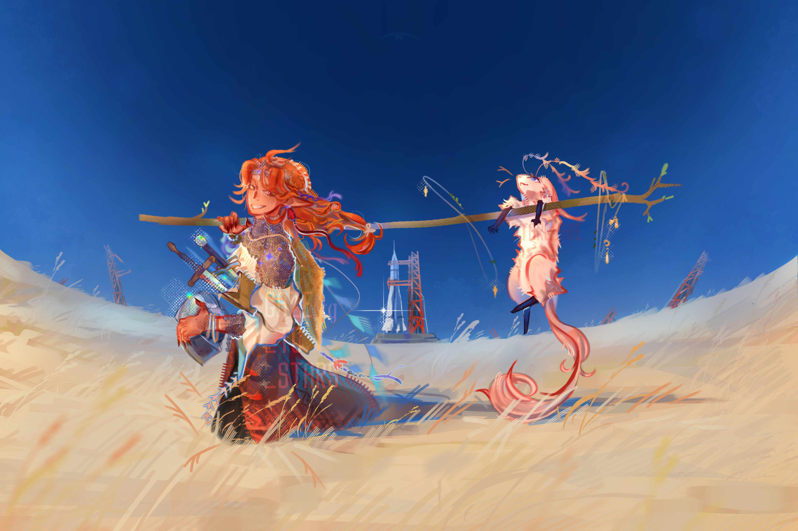
Часть анимаций будет создана покадрово, иная часть создана с помощью специальный утилит и/или сторонних программ (так называемая костная анимация). Возможно использование процедурной анимации для генерации конкретных объектов окружения или деталей персонажей.

## Звук
Планируется использовать несколько слоёв звука, собранных на стоках, бессовестно у кого-то украденных или записанных самостоятельно.

| Эмбиентная музыка            | Фоновый аккомпанемент, сопровождающий игрока при путешествии по локации. Электронное звучание, во многом схожее с музыкой из игры Rain World. Используется для добавление атмосферы                                                                  |
| ---------------------------- | ---------------------------------------------------------------------------------------------------------------------------------------------------------------------------------------------------------------------------------------------------- |
| Звуки персонажа              | Саларик при своём перемещении издаёт различных звуки: его хитиновые лапки чокают по полу, мы можем слышать звук его коготков и трения пуза о палку, когда он лазает. Может быть слышно шуршание его шерсти и его небольшое помявкивание при падении. |
| Звуки окружения              | По всей локации гуляет ветер, мы можем услышать скрежет древней конструкции, работу каких-то неизведанных машин. При толкании предметов также желательно установить соответствующий звук                                                             |
| Озвучка второго персонажа??? | При наличии материала можно добавить озвучания второму персонажу - Альтаиру, чьё руководство сопровождает нас всю демоверсию                                                                                                                         |

## Технические аспекты
Среда и инструменты

| Категория       | Выбор                                | Зачем                                                       |
| --------------- | ------------------------------------ | ----------------------------------------------------------- |
| Игровой движок  | Unity 6 6000.4.9f1, 2D-проект        | Основной движок, 2D-освещение при необходимости             |
| Язык            | C#                                   | Скрипты игровой логики                                      |
| Ввод            | Unity Input System                   | Схема управления для клавиатуры                             |
| Уровни          | Prefab-блоки и сцена                 | Быстрая сборка локации из готовых элементов                 |
| Камера          | Cinemachine                          | Слежение за персонажем, ограничение камеры границами уровня |
| Физика          | Physics 2D (Rigidbody2D, Collider2D) | Движение персонажа, передвигаемые блоки, триггеры           |
| UI              | Unity UI (uGUI) + TextMeshPro        | Текстовые поп-апы, подсказки                                |
| Контроль версий | GitHub                               | Совместная работа                                           |
| IDE             | Visual Studio                        | Разработка скриптов                                         |
Проект строится на четырёх простых идеях:

1. **Компонентный подход.** Каждый объект в игре состоит из небольших скриптов с одной задачей (например, `Door` только открывается и закрывается, а не решает, кто и чем его открыл).
2. **Общий интерфейс для взаимодействия.** Всё, с чем игрок может взаимодействовать (дверь, компьютер, люк, блок), реализует интерфейс `IInteractable`. Игроку не нужно знать, что именно перед ним: он просто вызывает `Interact()`.
3. **Связь через события, а не прямые ссылки.** Компьютер не «знает» про конкретный люк, а отправляет сигнал, на который подписан люк. Так объекты можно переставлять в сцене без правки кода.
4. **Данные отдельно от логики.** Тексты туториала, параметры игрока (скорость, высота прыжка) хранятся в ScriptableObject, а не прописаны в коде. Менять баланс можно без перекомпиляции и без риска сломать скрипты.

![[Pasted image 20261105204818.png]]

**Player**

- `PlayerController` управляет персонажем через простую конечную машину состояний: _Idle → Run → Jump → Fall → Climb_. Каждое состояние знает, во что можно перейти, поэтому не возникает «спагетти» из условий.
- `PlayerInput` считывает ввод из Input System и передаёт его контроллеру.
- `PlayerInteractor` ищет рядом объект с `IInteractable` и вызывает `Interact()` по нажатию кнопки.
- `PlayerInventory` хранит собранные предметы (пока только ключ-карта).

**Interactables**

| Объект             | Скрипт          | Поведение                                                                                    |
| ------------------ | --------------- | -------------------------------------------------------------------------------------------- |
| Дверь              | `Door`          | Открыта или закрыта, может требовать ключ-карту                                              |
| Компьютер          | `Computer`      | При использовании отправляет сигнал (открывает люк или дверь)                                |
| Люк                | `Hatch`         | Открывается по сигналу                                                                       |
| Передвигаемый блок | `MovableBlock`  | Rigidbody2D, игрок толкает                                                                   |
| Ключ-карта         | `KeyCardPickup` | Подбирается, добавляется в инвентарь                                                         |
| Палки / верёвки    | `Climbable`     | Зона-триггер: внутри неё игрок переходит в состояние Climb (вертикальное или горизонтальное) |

**Core**
- `GameManager` отвечает за состояние игры, паузу и перезапуск.
- `GameEvents` (или `EventChannel` на ScriptableObject) даёт общую «шину» сигналов, например `OnComputerActivated`, `OnKeyCardCollected`.

Целевая платформа и требования

- Платформа: ПК (Windows), сборка Standalone.
- Управление: клавиатура
- Разрешение: 16:9, масштабирование через Canvas Scaler и Pixel Perfect Camera (если стиль пиксельный).

## Производительность
авыавы

## Аналитика
Для нашей микродемки аналитика и телеметрия будут сфокусированы исключительно на проверке базовой играбельности, удобства управления и первого эмоционального отклика игрока. Главная цель сбора данных на этом этапе — понять, удается ли нам разжечь в пользователе искру любопытства и затянуть его в исследование этого очень необычного, неизведанного мира. Мы хотим убедиться, что именно жажда открытий и интерес к загадочному окружению ведут игрока вперед, а не простое следование по линейному маршруту.
На основе собранных данных мы выстраиваем метрики вовлечения, где критически важными становятся конверсия прохождения демки, средняя длительность сессии и глубина исследования доступных зон. Мы ищем точки фрустрации, которые вычисляются через аномально высокую частоту смертей на паркуре или слишком долгое топтание на одном месте возле головоломок. Анализ этих точек поможет нам скорректировать баланс и сделать управление максимально отзывчивым, чтобы технические огрехи прыжков или перегруженные загадки не разрушали хрупкое ощущение тайны и не мешали игроку погружаться в атмосферу неизведанного.

## Монетизация/экономика
В рамках монетизации и экономики игра будет распространяться по классической премиальной модели в цифровом магазине Steam по фиксированной стоимости, полностью исключая любые внутриигровые покупки, микротранзакции или платные механики. Основной акцент делается на сохранение целостности повествования и погружения в оригинальную вселенную. Финансовый успех проекта завязан исключительно на первичных продажах копий, а в долгосрочной перспективе экономическая модель может расширяться за счет выпуска крупных сюжетных дополнений, расширяющих лор и мир игры. Для обеспечения полной творческой свободы и защиты авторского видения от внешнего вмешательства издателей, финансирование планируется осуществлять полностью независимо. Одним из ключевых инструментов привлечения средств станет краудфандинг, который позволит монетизировать интерес преданного сообщества еще на этапе разработки, предлагая бэкерам эксклюзивные цифровые бонусы, связанные со вселенной и персонажами.

## Маркетинг и релиз
Маркетинговая стратегия и подготовка к релизу строятся вокруг уникального визуального стиля, глубокого лора и харизматичных персонажей, которые уже на ранних этапах демонстрируют органический прирост аудитории в личных социальных сетях. Основной упор в продвижении делается на контент-маркетинг в этих медиаресурсах с демонстрацией концепт-артов, анимаций и деталей сюжета, что позволяет формировать ядро лояльных фанатов до появления официальных трейлеров. Вся эта активность будет аккумулировать трафик на официальной странице проекта в Steam, которая станет главным хабом для сбора вишлистов. На странице будут представлены атмосферные скриншоты, демонстрирующие необычный мир, загадочный кинематографичный трейлер, интригующее текстовое описание завязки сюжета и тщательно подобранные ключевые слова для поисковых алгоритмов. В рамках релиза игра сразу нацеливается на широкую международную аудиторию, поэтому текстовая локализация закладывается с самого начала на несколько ключевых языков, включая английский.

## QA и тестирование
Процесс обеспечения качества и тестирования разделен на проверку технической стабильности и оценку геймплейного восприятия игроками. Техническая часть включает в себя регулярное прохождение внутренних чек-листов, проведение дымового тестирования для проверки работоспособности базовых функций после каждой сборки и регрессионное тестирование для контроля того, чтобы новые исправления не ломали уже работающие механики паркура и загадок. Все обнаруженные дефекты заносятся в баг-репорты с жесткой приоритизацией от критических блокирующих ошибок до мелких визуальных багов, а каждая стабильная сборка получает фиксированную версию. Оценка играбельности фокусируется на доступности головоломок и понятности навигации, гарантируя, что игрок всегда получает прозрачную обратную связь от окружения при решении задач. Кросс-платформенное тестирование направлено на проверку стабильной производительности на ПК разной мощности и бесшовную адаптацию интерфейса и управления под клавиатуру и геймпады, что критически важно для плавного паркура. Важнейшим этапом сбора обратной связи станут закрытые плейтесты с ограниченным кругом участников из числа лояльной аудитории соцсетей, которые будут заполнять подробные анкеты после прохождения, помогая выявить слабые места в балансе и повествовании.
## План обновлений
План обновлений и долгосрочной поддержки игры сфокусирован на постепенном полинге проекта после релиза на основе собранных отзывов и рецензий в Steam. Первые недели после выхода будут посвящены оперативному выпуску патчей для исправления редких технических ошибок, оптимизации и тонкой настройки баланса сложности на основе жалоб или пожеланий игроков. В среднесрочной перспективе планируется добавление бесплатных контентных обновлений, улучшающих качество жизни игрока, таких как расширенная карта мира, бестиарий или галерея концепт-артов для фанатов лора. В случае коммерческого успеха и высокого интереса аудитории к неизведанной вселенной, долгосрочный план включает в себя разработку масштабного сюжетного дополнения, которое добавит новые локации, уникальные механики и расскажет скрытую предысторию мира или второстепенных персонажей.

## Приложения
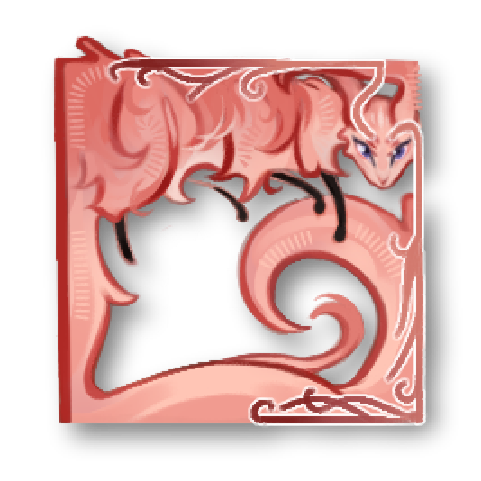

## Геймплей на будущее ААААААААА

**Игра чётко поделена на два геймплейных "акта": до потери возможности спать и после.**
На каком-то этапе игры саларик вознесётся настолько, что вместо сна начнёт проваливаться в Саларий и видеть его сны (симуляции) о былом, путешествуя по ним он будет сталкиваться с местными опасностями и узнавать больше о прошлом мира. Это легальное путешествие в прошлое, расширяющее место действия с острова на Пантеон и Ахор.

**Игровые столпы:**

| Эволюция главного героя, как в геймплейном, так и в нарративном плане          | "Метроидвания" во всех смыслах слова, развитие персонажа плотно сопряжено с лором мира                                                            |
| ------------------------------------------------------------------------------ | ------------------------------------------------------------------------------------------------------------------------------------------------- |
| Полностью оригинальный сеттинг                                                 | Привлечение внимания необычными персонажами, их культурой, визуальными и стилистическими решениями                                                |
| Постоянное взаимодействие с напарником - Альтаиром                             | Его можно расспрашивать вещах, он проводит туториал, он сопровождает нас по всему ходу нашего приключения, помогая игроку                         |
| Исследование мира                                                              | Механика в угоду "эволюции", должна быть привлекательна нарративно и обоснована геймплейно                                                        |
| Трагичная история мира с необычной философией, но при этом приятной атмосферой | Необычный и жизнеутверждающий контраст, выделяющий произведение на фоне других метроидваний (соус-лайков), что наполнены более мрачной атмосферой |

Геймплей во многом схож с иными представителями жанра, но больше нарративно направлен. 

| Название механики                    | Описание                                                                                                                                                                                                                                       |
| ------------------------------------ | ---------------------------------------------------------------------------------------------------------------------------------------------------------------------------------------------------------------------------------------------- |
| Передвижение                         | Базовая механика, рывок доступен со старта, иные способности могут открываться. Персонаж должен уметь лазать по определённым местам и прыгать, <mark style="background:rgba(163, 67, 31, 0.2)">может совершенствоваться с развитием</mark>     |
| Сохранение                           | Привычные лавки (костры), могут быть сложнее стилизованы под нечто как убежища (Rain World). Возможна установка убежища в выбранном месте                                                                                                      |
| Диалоги                              | Персонаж будет со времен учиться понимать других существ, изначально он способен говорить исключительно с Альтаиром                                                                                                                            |
| Умение читать и писать               | Открывается со временем, позволит решать головоломки (в том числе и Qte) в мире для открытия новых путей, а также получения лорной информации                                                                                                  |
| Добывание пищи                       | Под вопросом (схожесть с RW), саларик всеяден, может быть реализована как угодно                                                                                                                                                               |
| Какие-либо паркурные инструменты     | Во многих метроидваниях есть скиллы, являющиеся в первую очередь элементами паркура. В данный момент нет прямых идей                                                                                                                           |
| Использование различных инструментов | В какой-то момент времени саларик начнёт таскать на себе несколько устройств, которые будут помогать ему при перемещении по миру, охоте и проч                                                                                                 |
| Боевая система                       | Под вопросом, не вижу прямой реализации как в HK или Nine Sols, может быть косвенна, как в RW. <mark style="background:rgba(163, 67, 31, 0.2)">Обсуждается</mark>                                                                              |
| Мысли                                | Вдохновлена Dicso Elysium, некий билдострой, а-ля используемые в данный момент способности/амулеты, которые можно будет изменять на чекпоинте. <mark style="background:rgba(163, 67, 31, 0.2)">Может быть раскидано по разным механикам</mark> |
| Перемещение по Саларию               | Поздние этапы игры, дополнительные механики для движения через сны                                                                                                                                                                             |

**Этапы игры**

Нарративно: 3-х актовая система.
1. Изучение мира, непонимание происходящего и только разгон конфликта с несколькими ключами и загадками (<mark style="background:rgba(163, 67, 31, 0.2)">нужно доделать в самое начало прямую цель, чтобы оправдать первичный геймплей</mark>);
2. Саларик уже начинает что-то понимать и выбирать свой путь, начало проваливания в сны;
3. Полное осознание происходящего, окончательное деление на концовки, кульминация.

Геймплейно: множество локаций, напрямую на акты не поделённые, одна ключевая механика, делящая игру пополам. 

